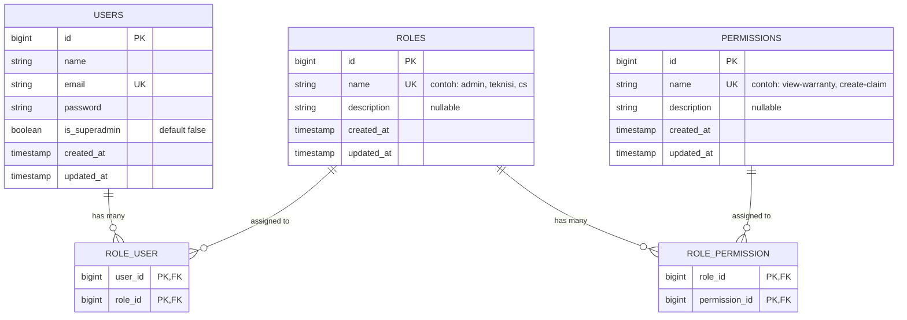

# Spesifikasi Sistem Desain & ERD: Role & Permission (RBAC)

Dokumen ini disusun sebagai panduan teknis dan referensi bagi pengembang (backend/controller) dalam mengimplementasikan endpoint API untuk manajemen Role, Permission, dan Otorisasi.

---

## 1. Entity Relationship Diagram (ERD)

Struktur relasi database yang telah disiapkan di migration Laravel:



---

## 2. Model Eloquent & Helper yang Sudah Tersedia

Di model `App\Models\User`, sudah disediakan helper method otomatis yang **mem-bypass verifikasi jika user adalah Superadmin**:

```php
// 1. Cek apakah user punya role tertentu
$user->hasRole('admin'); 
// Return true jika user punya role 'admin' ATAU jika is_superadmin == true

// 2. Cek apakah user punya hak akses/permission tertentu
$user->hasPermission('view-warranty'); 
// Return true jika permission ada di salah satu role user ATAU jika is_superadmin == true

// 3. Relasi Many-to-Many bawaan
$user->roles; // Collection dari Role
$role->permissions; // Collection dari Permission
$role->users; // Collection User yang memiliki role tsb
$permission->roles; // Collection Role yang memakai permission tsb
```

---

## 3. Rencana Endpoint API (CRUD untuk Rekan Pengembang)

Semua endpoint di bawah ini idealnya dilindungi middleware autentikasi Sanctum dan pengecekan Superadmin:

### A. Manajemen Role (`/api/roles`)
| Method | Endpoint | Deskripsi | Request Body Contoh |
|---|---|---|---|
| `GET` | `/api/roles` | Daftar semua role beserta permissionnya | - |
| `POST` | `/api/roles` | Superadmin membuat role baru | `{"name": "teknisi", "description": "Petugas servis"}` |
| `PUT` | `/api/roles/{id}` | Update nama/deskripsi role | `{"name": "teknisi-lapangan"}` |
| `DELETE` | `/api/roles/{id}` | Hapus role | - |
| `POST` | `/api/roles/{id}/permissions` | Pasang/sinkronkan permissions ke role | `{"permissions": [1, 2, 5]}` |

### B. Manajemen Permission (`/api/permissions`)
| Method | Endpoint | Deskripsi | Request Body Contoh |
|---|---|---|---|
| `GET` | `/api/permissions` | Daftar seluruh nama permission/fitur | - |
| `POST` | `/api/permissions` | Tambah permission baru | `{"name": "approve-claim", "description": "Menyetujui klaim"}` |

### C. Assign Role ke User (`/api/users/{id}/roles`)
| Method | Endpoint | Deskripsi | Request Body Contoh |
|---|---|---|---|
| `POST` | `/api/users/{id}/roles` | Menetapkan role ke user tertentu | `{"roles": [1, 2]}` |

---

## 4. Pola Implementasi di Controller (Snippet Siap Pakai)

### Sync Permissions ke Role:
```php
public function syncPermissions(Request $request, Role $role)
{
    $request->validate([
        'permissions' => 'required|array',
        'permissions.*' => 'exists:permissions,id',
    ]);

    // Menggunakan Eloquent sync bawaan Laravel
    $role->permissions()->sync($request->permissions);

    return response()->json([
        'message' => 'Permissions successfully updated for role ' . $role->name,
        'role' => $role->load('permissions'),
    ]);
}
```

### Middleware / Pengecekan Permission di Endpoint Fitur:
```php
// Contoh proteksi endpoint di Controller action
if (! $request->user()->hasPermission('view-warranty')) {
    return response()->json(['message' => 'Forbidden: Anda tidak memiliki akses fitur ini.'], 403);
}
```
*(Catatan: Akun dengan `is_superadmin = true` otomatis tembus / return `true` pada pengecekan di atas).*
